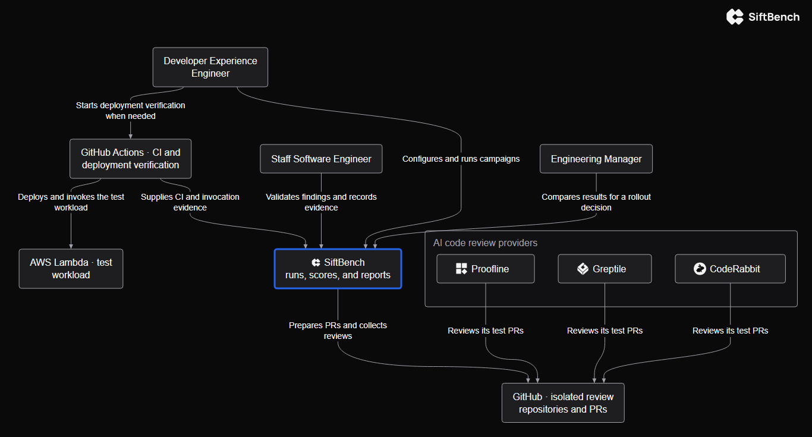
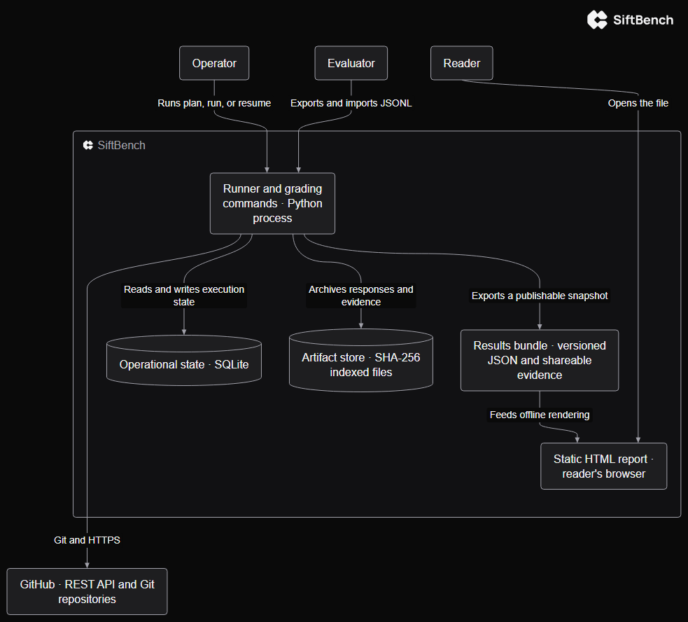
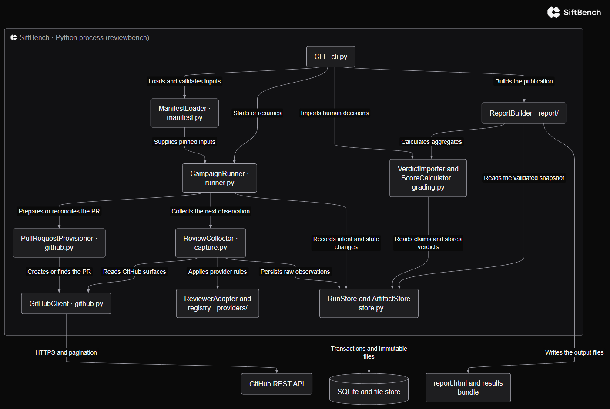
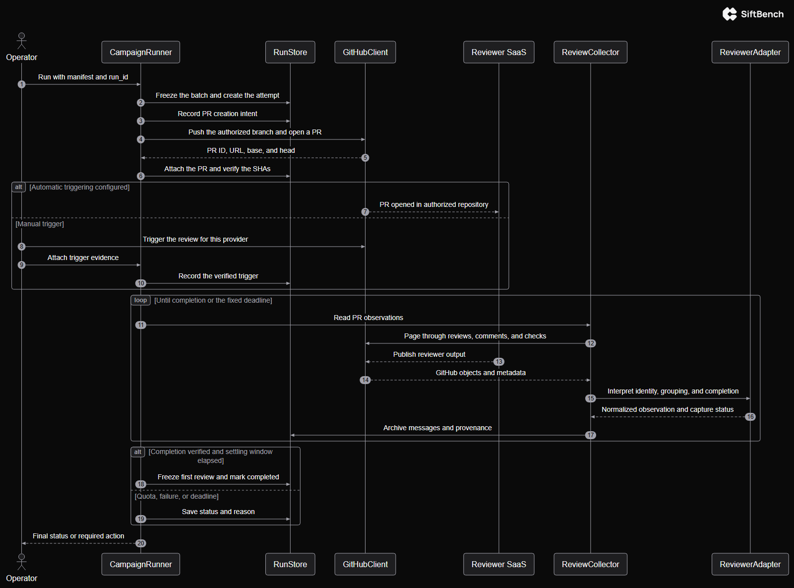
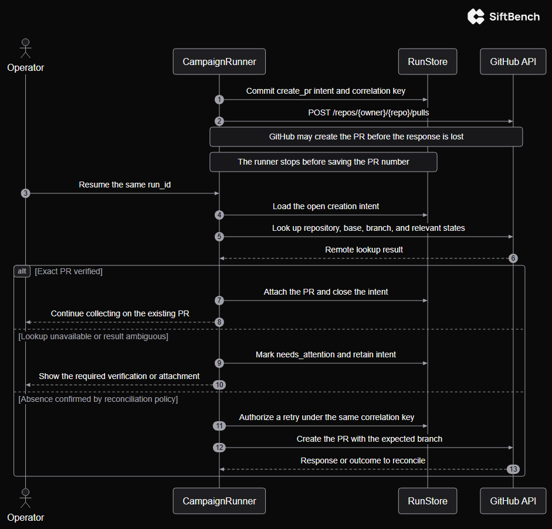
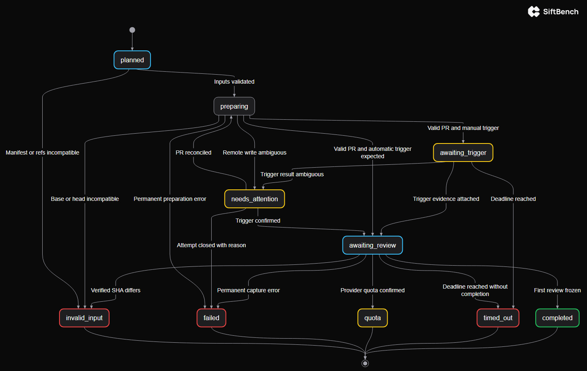
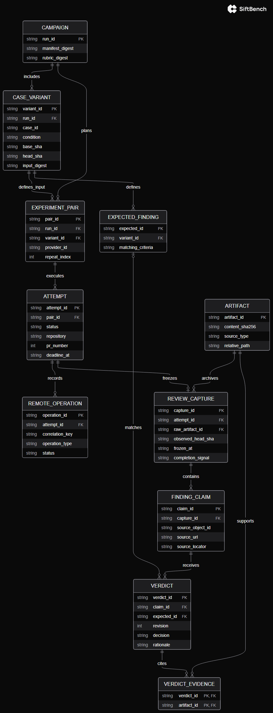
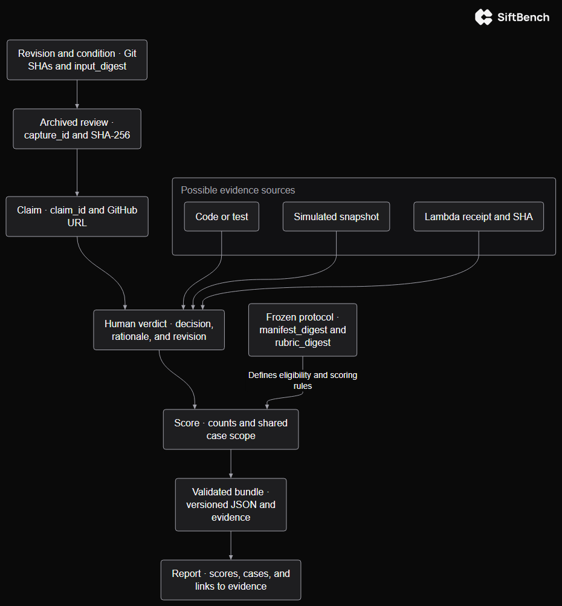
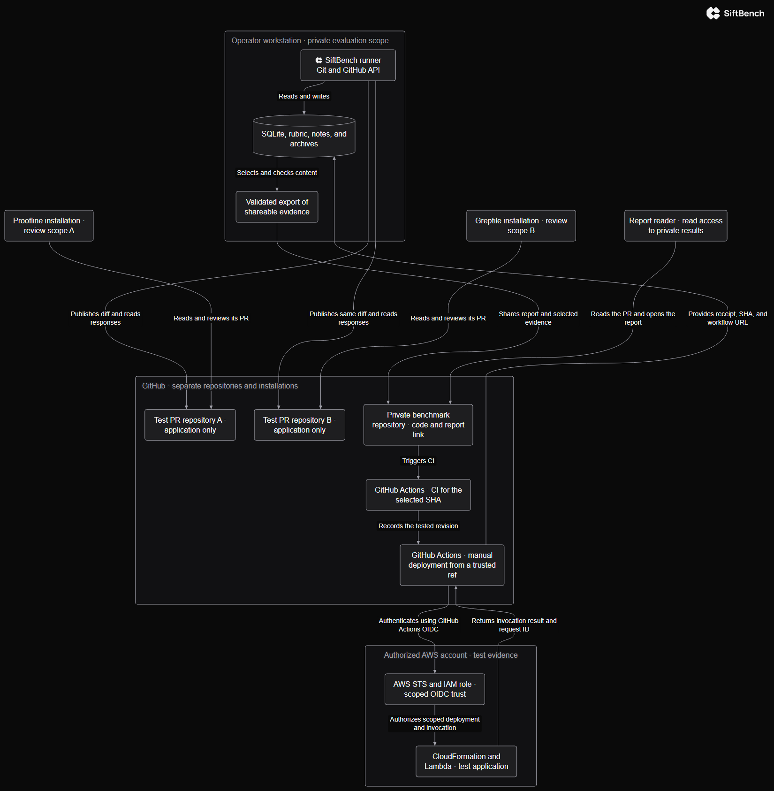

# SiftBench Architecture

**Design decision.** SiftBench compares AI code reviewers on pinned GitHub pull requests. A Python runner collects reviews, SQLite stores campaign state and evidence references, and a static web report presents the findings and recorded verdicts. Archived inputs and verdicts reproduce a score. A new review from a provider may differ even with the same inputs.

This document describes the runner, evidence store and report generator. The diagrams below use the same theme as the [browser gallery](ARCHITECTURE.html). Each diagram links to its editable Mermaid source and full-size image.

## How to read the diagrams

- **01-03** follow the C4 context, container, and component levels. The context shows people and external systems. Containers show execution and storage units. Components show what happens inside the Python process. Container has the C4 meaning here.
- **04-05** show interactions in time. The first follows a normal review. The second covers a lost response after remote PR creation, when a blind retry could create a duplicate.
- **06-07** describe operational states and data relationships. One answers what the runner can do next. The other answers which records support that decision.
- **08-09** show how scores are derived and where deployment trust boundaries lie. A code test, simulated snapshot, and AWS observation have different scopes.

The structural views follow C4, and the sequence diagrams follow arc42's runtime view. [C4 diagrams](https://c4model.com/diagrams) · [arc42 runtime view](https://docs.arc42.org/section-6/)

## Diagram and project theme

The diagrams use the [shared project palette](theme.css). Text labels carry the meaning of status colors. The web report uses the same tokens.

## 01. System context

[Full-size PNG](diagrams/01-system-context.png) · [Editable Mermaid source](diagrams/01-system-context.mmd)

A **Developer Experience Engineer** runs a controlled comparison of review tools. A **Staff Software Engineer** checks findings against code, tests, or deployment evidence. An **Engineering Manager** uses the report to decide which reviewer to pilot or roll out. Each provider works on its own test PRs. The same engineer can operate the benchmark and adjudicate findings on a smaller team. [GitLab Developer Experience](https://handbook.gitlab.com/handbook/engineering/infrastructure-platforms/developer-experience/)

The context diagram uses the three providers' official monochrome marks. [Proofline press kit](https://proofline.sh/press/) · [Greptile brand guidelines](https://www.greptile.com/design) · [CodeRabbit press kit](https://www.coderabbit.ai/press-kit)

## 02. C4 containers

[Full-size PNG](diagrams/02-c4-containers.png) · [Editable Mermaid source](diagrams/02-c4-containers.mmd)

`reviewbench report` reads local state or the exported bundle. The generator can run on another machine using the bundle. The browser reads the HTML and resolves attached files through relative paths. GitHub links follow the reader's access permissions. The report needs no API credentials. [Inspect AI log viewer](https://inspect.aisi.org.uk/log-viewer.html) · [Playwright HTML reporter](https://playwright.dev/docs/test-reporters#html-reporter)

**Deployment choice.** One process and one local database fit a campaign driven by an operator. They keep recovery testable and support offline distribution. A durable distributed queue becomes relevant if multiple machines must work on one campaign or measured throughput outgrows the local runner. SQLite serializes writes. A process lock per campaign workspace also coordinates runner activity across GitHub calls. [SQLite isolation](https://www.sqlite.org/isolation.html)

## 03. Python components

[Full-size PNG](diagrams/03-python-components.png) · [Editable Mermaid source](diagrams/03-python-components.mmd)

- `ManifestLoader` validates cases, conditions, SHAs, and allowed repositories. It produces the resolved manifest saved with the campaign. `resume` reloads it and checks its digest.
- `CampaignRunner` picks actions from attempt state and owns deadline policy. `PullRequestProvisioner` materializes the diff and reconciles a PR by repository, base, and branch. `GitHubClient` owns HTTP transport, pagination, and rate limits.
- `ReviewerAdapter` describes publisher identity, trigger mode, and the completion signal verified on a pilot PR. `ReviewCollector` archives messages and checks their scope. Manual triggers can be tracked with evidence recorded by the operator.
- `VerdictImporter` validates recorded decisions. `ScoreCalculator` operates on a frozen batch and can be tested in memory. `ReportBuilder` renders from the same result model as the Markdown summary. With `--bundle`, it loads the validated JSON snapshot in place of local state.

Review output can arrive through several GitHub API surfaces. Reading those surfaces and deciding that a review is complete are separate responsibilities. [GitHub reviews](https://docs.github.com/en/rest/pulls/reviews) · [Inline comments](https://docs.github.com/en/rest/pulls/comments) · [General comments](https://docs.github.com/en/rest/issues/comments) · [Check runs](https://docs.github.com/en/rest/checks/runs)

## 04. Normal review sequence

[Full-size PNG](diagrams/04-normal-review-sequence.png) · [Editable Mermaid source](diagrams/04-normal-review-sequence.mmd)

Where the provider exposes a completion signal, the adapter distinguishes a finished review with zero findings from a review still in progress. The runner waits for evidence of completion and times out at the deadline. Late comments and edits may be archived with timestamps. The graded bundle preserves the selection frozen by the protocol, including separately published comments that can be attributed to the first complete review. [Proofline experiment guide](https://github.com/prooflinedev/ai-review-benchmarks/blob/main/docs/experiment.md)

## 05. Recovery after a lost PR response

[Full-size PNG](diagrams/05-recovery-after-a-lost-pr-response.png) · [Editable Mermaid source](diagrams/05-recovery-after-a-lost-pr-response.mmd)

**Guarantee.** A write timeout opens a reconciliation step because GitHub may already have applied the request. The correlation key is local. Find the PR using the stable branch name and expected base, then verify its SHA. When an empty result is insufficient evidence of absence, retry the read within a bounded window and use `needs_attention` if uncertainty persists. If a manual trigger remains uncertain, the operator attaches evidence or explicitly decides how to proceed. The resulting state reflects evidence available on both sides of the boundary. [GitHub pull requests API](https://docs.github.com/en/rest/pulls/pulls) · [GitHub REST best practices](https://docs.github.com/en/rest/using-the-rest-api/best-practices-for-using-the-rest-api) · [AWS retries and jitter](https://aws.amazon.com/builders-library/timeouts-retries-and-backoff-with-jitter/)

## 06. Attempt state machine

[Full-size PNG](diagrams/06-attempt-state-machine.png) · [Editable Mermaid source](diagrams/06-attempt-state-machine.mmd)

- A temporary GitHub API limit preserves the current state and schedules the next poll. `quota` represents a confirmed provider allowance restriction.
- Each transition records its timestamp, cause, and attempt ID. The absolute deadline survives interruption. Late captures can be archived with timestamps while the frozen attempt remains stable. A new measurement creates an explicit retry or repeat under the campaign rules.
- `completed` describes the review. Grading progress comes from the attempt's claims and verdicts. The report can show a completed review with grading still in progress.

## 07. Relational data model

The diagram shows entities and the keys used for traceability. Migrations will specify SQLite types, indexes, constraints, and defaults.

[Full-size PNG](diagrams/07-relational-data-model.png) · [Editable Mermaid source](diagrams/07-relational-data-model.mmd)

**Constraints.** A pair is unique across campaign, variant, provider, and repeat index. Resuming an interrupted attempt preserves its ID. A retry after a terminal failure creates a new attempt for the same pair. An intentional repeat creates a new pair with a different repeat index. The export selects one canonical observation per pair using a rule fixed before grading. Multiple mentions of one defect count once toward that pair's recall.

**Write order.** Write the raw file to a temporary path on the same volume, then move it to its digest-addressed path. Verify the digest before committing the SQLite reference and state transition. A process crash can leave an unreferenced file. An invalid reference makes the observation ineligible until verified. The SQLite transaction covers local database changes. Recovery handles the file store and GitHub separately. [SQLite atomic commit](https://www.sqlite.org/atomiccommit.html) · [SQLite isolation](https://www.sqlite.org/isolation.html)

## 08. Score and evidence provenance

[Full-size PNG](diagrams/08-score-and-evidence-provenance.png) · [Editable Mermaid source](diagrams/08-score-and-evidence-provenance.mmd)

Evidence types include `code`, `test`, `case_snapshot`, and `aws_live`. A verdict can cite multiple pieces and the report shows the scope of each one. Scores expose numerators, denominators, and shared cases. Verified novel findings remain visible while the reference set stays frozen. A corrected verdict retains its rationale, evidence, and rubric version as a new revision. Recompute the score offline from the corresponding bundle. [GitHub ReviewBench methodology](https://github.com/review-bench/ReviewBench/blob/main/docs/METHODOLOGY.md) · [SLSA provenance concepts](https://slsa.dev/spec/v1.2/provenance)

## 09. Deployment and trust boundaries

[Full-size PNG](diagrams/09-deployment-and-trust-boundaries.png) · [Editable Mermaid source](diagrams/09-deployment-and-trust-boundaries.mmd)

Reviewer installations can access their designated test repositories. The rubric and grading notes stay in the private evaluator workspace. Report readers receive a curated export with the report and selected evidence.

The diagram shows an example of collecting deployment evidence with GitHub Actions and AWS Lambda. This workflow runs independently of reviewer capture. It records the PR SHA, CI-tested SHA, packaged revision, and invocation ID. If CI tested a synthetic merge commit, verify the selected head separately before attributing the result to it. The Lambda receipt applies to the workload actually invoked. A simulated snapshot describes an input to a benchmark case. [GitHub OIDC for AWS](https://docs.github.com/en/actions/how-tos/secure-your-work/security-harden-deployments/oidc-in-aws) · [Example deployment and receipt](https://github.com/prooflinedev/ai-review-benchmarks/blob/main/docs/aws.md)

## Decisions to verify before implementing integrations

1. **Provider completion signals.** On an independent pilot PR, record the API endpoint, publisher identity, source link, and any completed reviews with no comments. Define a capture policy for ambiguous completion before collecting benchmark results.
2. **Remote-write recovery.** Stop the process after remote creation. Verify that the intent survived, the runner finds the existing PR, and the creation counter remains one.
3. **Fair comparison.** Verify that providers can see the same context. Pin SHAs and settings, define the shared case block, and record the repeat policy.
4. **Scoring replay.** Render the same bundle twice. Verify equal counts and internal links, offline opening, and navigation from a score to evidence.
5. **Access and publication.** Verify what each installation can read, what the bundle exports, and what the reader can open. Separately verify AWS role scope and the match between SHA and receipt.

