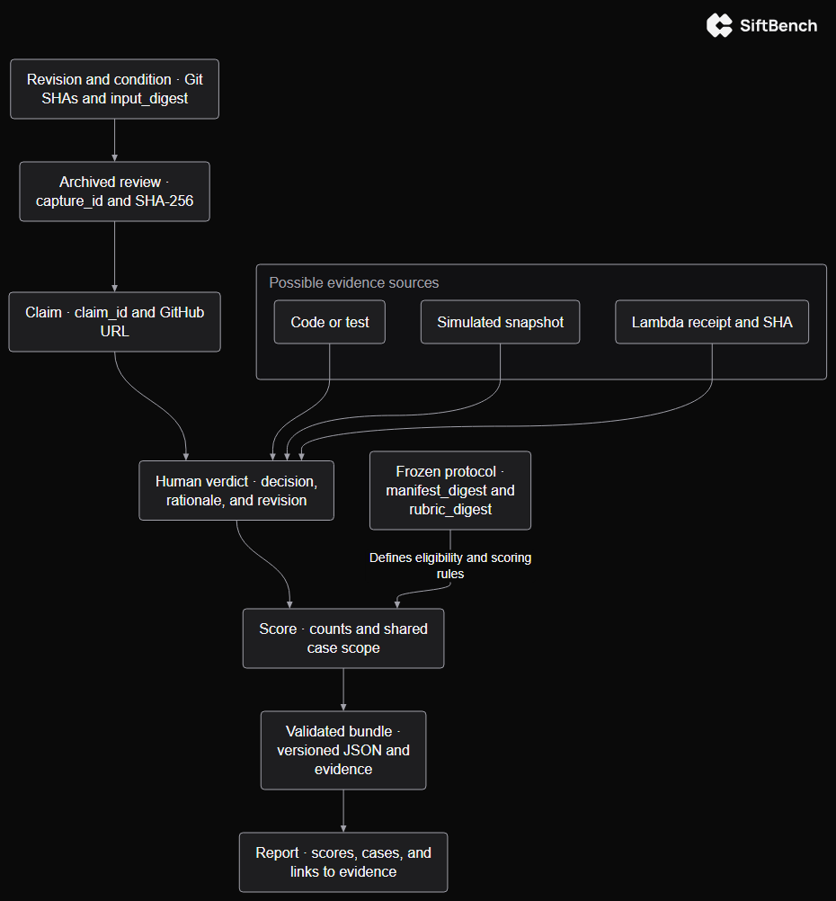

<p align="center">
  
</p>

# Compare AI code reviewers on the same changes

SiftBench runs reviewers on pinned GitHub pull requests, saves the first eligible review, and traces each scored finding to its comment, verdict, and supporting evidence. The Python runner can resume an interrupted campaign. The HTML report can be rebuilt offline from an archived bundle.

[Quickstart](#quickstart) · [Results](#benchmark-results) · [Architecture](ARCHITECTURE.md) · [Run your own campaign](docs/operations.md) · [CI](https://github.com/Txchrixo/siftbench/actions/workflows/ci.yml)

## Benchmark results

Three reviewers each covered 50 pinned changes. All **150 reviews** were verified against their GitHub publications. Two cases had unresolved findings, leaving **48 shared cases** for scoring.

| Reviewer | Completed | Precision | Reference recall |
| --- | ---: | ---: | ---: |
| CodeRabbit | 50/50 | 50/50 (100%) | 22/34 (65%) |
| Greptile | 50/50 | 45/46 (98%) | 22/34 (65%) |
| Proofline | 50/50 | 39/43 (91%) | 16/34 (47%) |

The reviewers agreed on 13 of the 34 reference findings and all missed eight. CodeRabbit and Greptile reached the same recall while catching different defects. Each tool reviewed each change once, so these results describe this campaign.

[Aggregate results and confidence intervals](benchmark/evaluation-v2/summary.json) · [Scoring and isolation](docs/operations.md#4-grade-reconcile-and-compare)

## Quickstart

Python 3.11 or newer. The pagination fixture runs offline with no API credentials.

```sh
python -m pip install -e .
reviewbench --state-dir .siftbench/quickstart run --manifest benchmark/fixtures/pagination/campaign.toml --fixture benchmark/fixtures/pagination/reviews.json
reviewbench --state-dir .siftbench/quickstart report --run-id pagination-pilot --out dist/pilot
```

Open `dist/pilot/report.html`. The fixture shows review capture and grading status. To replay it, run `reviewbench report --bundle dist/pilot/results.json --out dist/replay`.

## How it works

1. Pin the base, head, reviewer settings and reference rubric.
2. Provision isolated pull requests and match review publications to the pinned revision. Resume from saved state if collection stops.
3. Grade each finding and compare reviewers on fully graded shared cases. Rebuild the report from the same evidence.

<p align="center">
  
</p>

[System architecture](ARCHITECTURE.md) · [Recovery after an interrupted PR creation](diagrams/05-recovery-after-a-lost-pr-response.png) · [Campaign operations](docs/operations.md)

## Development

```sh
python -m pip install -e ".[test]"
python -m pytest
```

CI tests the runner and the installed wheel on the included fixtures. The [operations guide](docs/operations.md#5-share-the-appropriate-artifact) describes the data included in a public export.
